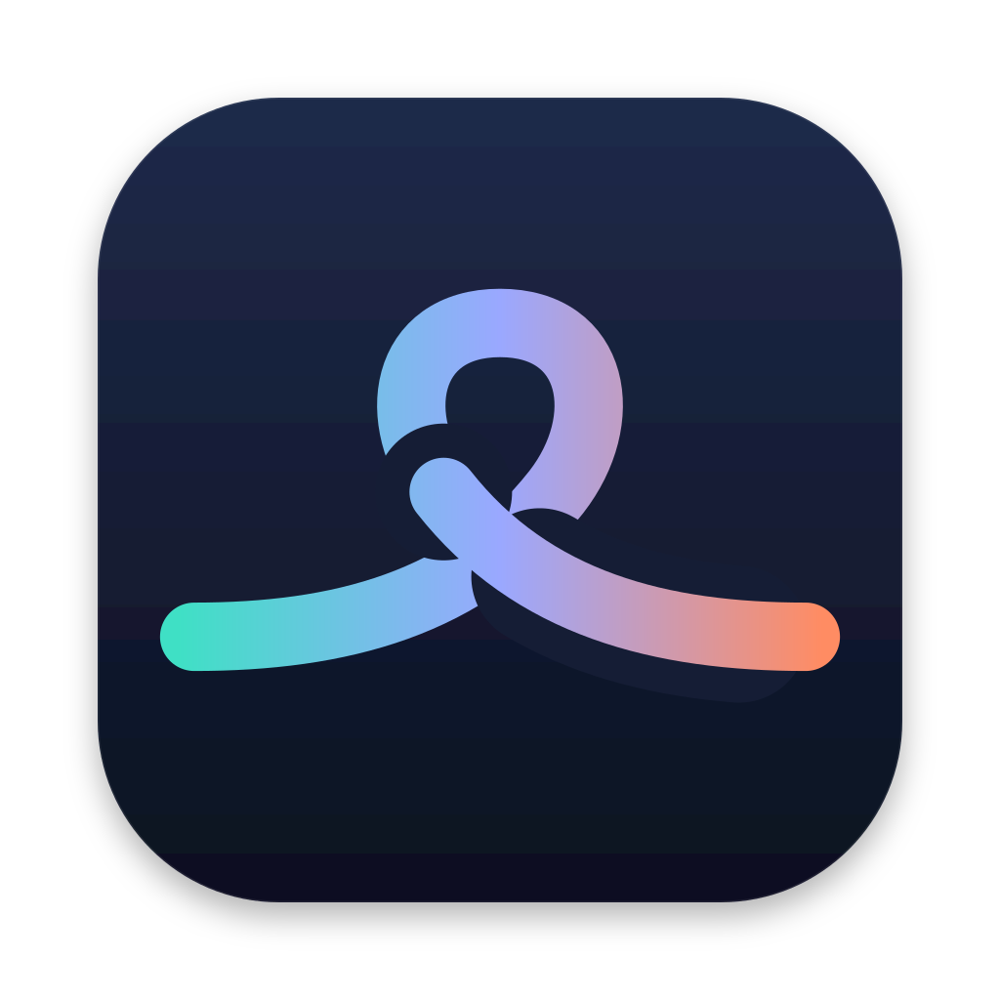
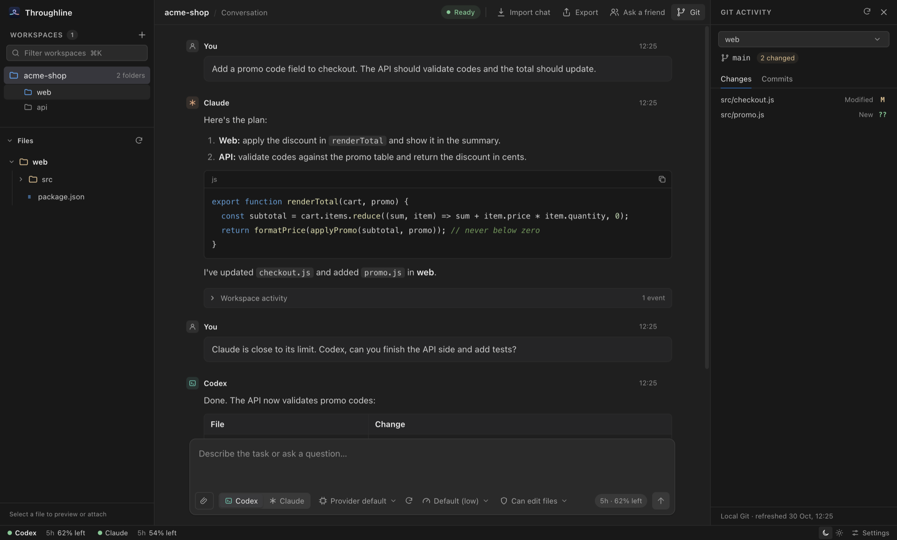

<p align="center"></p>

<h1 align="center">Throughline</h1>

<p align="center">Your control plane for agentic development.<br>Carry Claude Code, Codex, Gemini and local models through one continuous project thread.</p>

<p align="center"><a href="https://github.com/AhmedNavaz/throughline/actions/workflows/ci.yml"></a> <a href="https://github.com/AhmedNavaz/throughline/releases/latest"></a> <a href="LICENSE"></a> <a href="https://www.patreon.com/17048317/join"></a></p>

<p align="center"></p>

Throughline is an open-source desktop control plane for agentic development. It brings Claude Code, Codex, Gemini through Google Antigravity and downloaded Ollama coding models into a unified workspace for multi-agent orchestration, persistent project context, and human-in-the-loop collaboration.

Each project becomes a continuous working thread: its folders, conversation, saved context, and agent activity stay together as the work evolves. Carry work between agents, consolidate fragmented chat histories, inspect execution and code changes, and exchange reviewable patches with collaborators. Throughline runs through your installed agent CLIs and existing accounts, with you directing the workflow.

## Features

**Multi-agent orchestration and continuity**

- One permanent conversation per project, shared by all its folders, such as frontend, backend and website.
- Switch between Claude Code, Codex and Gemini mid-task, for example when one hits its usage limit. The next agent picks up the shared context.
- **Continue locally** with a downloaded Ollama coding model when cloud allowances run out. The same project thread carries over, using Codex's workspace tools and approvals with separate local-model attribution. See [setup and limits](docs/guide.md#local-models).
- Choose cloud agents and downloaded local models in one searchable picker, then use the same composer.
- Choose the model, reasoning effort and access (read only or can edit files) for every message.
- Approve agent actions in the app and follow each run live: current step, tool calls, elapsed time and token counts.
- Run agents in several workspaces at once; the sidebar shows which ones are busy.
- Find earlier messages and code with Cmd/Ctrl+F, highlighted matches and next/previous navigation.
- Get a second opinion with **Review**: a background agent checks a saved snapshot of selected changes in a side panel while you continue the next task. Findings become outdated when those files change.

**Execution visibility and developer controls**

- Git activity for each folder: changed files with diffs, and recent commits.
- A file browser with syntax-highlighted previews. Attach files and images by clicking, dragging or pasting.
- Plan usage for Claude Code and Codex in the status bar, with reset times, plus per-run context usage when reported.
- Keep awake: your Mac stays awake while agents are working and sleeps normally once they finish.
- Native desktop menus for workspaces, agents, conversation search, appearance and Help, with keyboard shortcuts and current selections.

**Context portability and human collaboration**

- Import Claude Code and Codex chats from any project, merged in time order.
- Export a conversation file for another Throughline user, with secrets and local paths removed.
- **Ask a Friend** prepares a help request from your current task and recent conversation. Optionally include changed files, review the preview, then export it or create a private link; returned patches require your review.

**A local workspace, powered by your accounts**

- System appearance alongside explicit Dark and Light themes, keyboard shortcuts, Markdown replies with highlighted code and copy buttons, and a short setup guide.
- Runs official Claude Code, Codex and Google Antigravity integrations on your own accounts. Gemini connects through Antigravity ACP with Google sign-in; Gemini CLI remains an advanced API-key/enterprise option. It ships no API keys and adds no model service of its own.

## Install

```sh
curl -fsSL https://raw.githubusercontent.com/AhmedNavaz/throughline/main/install.sh | sh
```

This installs the latest release for your Mac (Apple Silicon or Intel) after checking its published checksum. You also need at least one supported agent installed and signed in: [Claude Code](https://code.claude.com/docs/en/overview), [Codex CLI](https://github.com/openai/codex) or connect **Gemini with Google Antigravity** from Settings: **Install Google connection**, then **Connect account**. The download comes from Google and its checksum is verified before installation.

<details>
<summary>Other ways to install</summary>

**Download the app.** Get the zip for your Mac from [Releases](https://github.com/AhmedNavaz/throughline/releases/latest) and move **Throughline** to Applications. The app is not notarized by Apple yet, so the first time you open a browser download macOS says it cannot verify the developer: open **System Settings › Privacy & Security** and click **Open Anyway**. If macOS says the app is damaged, run `xattr -cr /Applications/Throughline.app`.

**Run from source** with Node.js 22.12 or later:

```sh
git clone https://github.com/AhmedNavaz/throughline.git
cd throughline
npm ci
npm start
```

</details>

## How it works

1. **Create a workspace** and add your project's folders.
2. **Pick Claude, Codex or Gemini** in the composer, choose the model and send. Switch agents whenever you like; the next one receives the shared conversation as context.
3. **Bring people and history in.** After opening a workspace, review the previous chats found for its folders, or use **Previous chats** to select and merge Claude Code and Codex conversations. **Export** hands a conversation to someone else, and **Ask a Friend** brings back a patch you review.

Inference starts only when you explicitly send a task, continue one or start a review. Runs use your installed tools and connected accounts, or a downloaded model through **Continue locally**. The [guide](docs/guide.md) covers each feature in detail, including limits and what is stored where.

## Roadmap

Next up: notarized macOS builds, automatic updates, resuming work as soon as a usage limit resets, Windows and Linux builds, and more agents and models such as Grok and DeepSeek. Further out: voice mode (say what you want, hear a short summary of what changed), automatic model and effort choice for each request, live progress in your Mac's menu bar or notch, and agents that review each other's work. See [ROADMAP.md](ROADMAP.md) for what has shipped and the full plan.

## Support Throughline

If Throughline helps your work, you can [support its development on Patreon](https://www.patreon.com/17048317/join). Sponsorship helps fund maintenance, fixes and new features.

## Contributing

Start with the [project map](CONTRIBUTING.md#project-map): `src/` contains the local backend, `desktop/` the Electron shell, `public/` the interface and `sharing/` the optional link service.

The most helpful thing you can do right now is use Throughline and tell us what you find: [report a bug](https://github.com/AhmedNavaz/throughline/issues/new?template=bug_report.yml) or [share design feedback](https://github.com/AhmedNavaz/throughline/issues/new?template=ux_feedback.yml). Code contributions are welcome too; [CONTRIBUTING.md](CONTRIBUTING.md) explains the setup, maps the codebase and lists where to start. Please report vulnerabilities privately as described in [SECURITY.md](SECURITY.md).

## License

[MIT](LICENSE). Throughline is an independent project, not affiliated with or endorsed by Anthropic, OpenAI or Google. Claude, Claude Code, Codex, Gemini and related names are trademarks of their respective owners.
