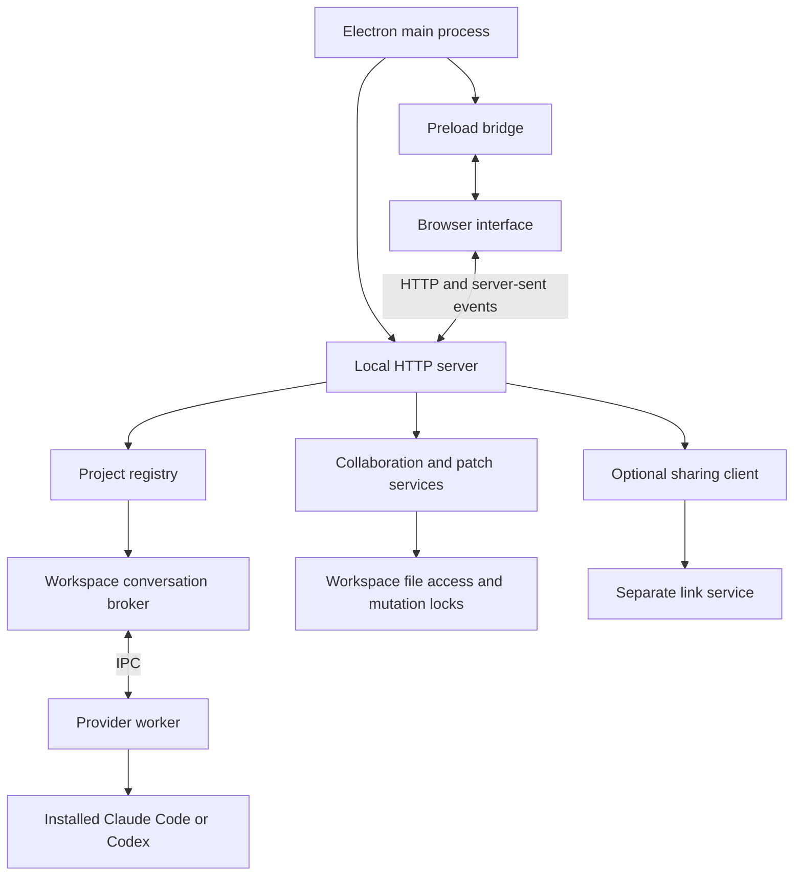

# Architecture

Throughline is a local desktop application: an Electron shell, a Node.js HTTP server and a static JavaScript interface. There is no frontend build step. The optional sharing service runs separately and handles Ask a Friend links.

## Runtime boundaries

`server.mjs` creates and connects services, applies request checks and dispatches routes. Domain modules take explicit dependencies; they do not import the server or Electron. The desktop main process owns server startup and shutdown. The interface has no direct Node.js or filesystem access.

| Area | Owner |
| --- | --- |
| Desktop lifecycle, native dialogs and trusted IPC | `desktop/main.mjs`, `desktop/preload.cjs` |
| App-version announcements and bundled changelog entries | `desktop/updates.mjs` |
| Temporary development profiles and data migration | `desktop/launch.mjs`, `desktop/storage.mjs` |
| Workspace identity, folders and one permanent conversation | `projects.mjs` |
| Conversation journal, accepted submissions, approvals and run lifecycle | `broker.mjs` |
| Shared prompt context | `context.mjs` |
| Agent protocol adapters and worker entry point | `providers.mjs`, `provider-worker.mjs`, `resolve-binary.mjs` |
| Review snapshots, validated findings, freshness and review HTTP routes | `agent-review.mjs`, `agent-review-routes.mjs` |
| History discovery, reviewed imports and portable exports | `conversation-routes.mjs`, `conversation-import.mjs`, `conversation-export.mjs` |
| File, attachment and Git HTTP routes | `workspace-routes.mjs` |
| Filesystem boundaries, baselines and mutation coordination | `workspace-files.mjs`, `workspace-layout.mjs`, `workspace-baseline.mjs`, `mutation-lock.mjs` |
| Reviewed collaboration packages and returned patches | `collaboration*.mjs`, `patches.mjs`, `sharing-client.mjs` |
| Independently deployable private-link storage and HTTP service | `sharing/` |

The backend modules stay at the repository root while this remains a small application. Split a module when it acquires a separate responsibility; moving every file into a new directory tree alone would not improve these boundaries. Production branding belongs in `assets/`, documentation in `docs/`, and disposable generated assets in `output/`, which is excluded from Git and desktop packages.

## Interface ownership

`public/app.js` owns workspace selection, conversation state, the composer, requests and the live event connection. It exposes `window.relayUI`; feature scripts use that API and listen for `relay-state` rather than keeping separate copies of the active workspace or conversation.

| Feature script | Responsibility |
| --- | --- |
| `insights.js` | Model and effort controls, run progress, account usage and Git activity |
| `conversation-history.js` | Previous-chat discovery, selection, review, merge and export |
| `setup.js` | Onboarding and saved preferences; announces `relay-setup-ready` after initial setup state loads |
| `updates.js` | In-app release notes after updates and from Help; waits for setup and workspace loading |
| `files.js` | File explorer, previews and attachments |
| `conversation-search.js` | Find in the conversation: match highlights, the match count and moving between matches |
| `agent-review.js` | Cross-agent review selection, explicit preview/start, findings and fix drafts |
| `workbench.js` | Ask a Friend review flow |
| `desktop-controls.js` | Native keep-awake controls |

The deferred scripts in `index.html` load the core API before its features, and history before setup can announce readiness. New scripts and styles also need an entry in the server's explicit static-asset allowlist. Interface tests exercise the actual scripts; HTTP tests check that the page's scripts and styles are served.

## State and operations

Each workspace has a stable ID, attached folder records and one permanent conversation ID in `projects.json`. Conversation events live in per-workspace JSONL journals; reopening a workspace replays those events. Preferences live in `settings.json`. Electron keeps this data under its user-data directory; browser-only development uses `.data/` by default. CLI credentials remain managed by the installed agents. The guide describes the user-facing storage and migration behavior.

A submitted message carries a request ID so retrying after a lost response does not run the same task twice. The broker records the submission, starts a provider worker and turns worker events into journal entries and live updates. The UI refreshes the corresponding workspace and rejects stale responses after selection changes.

Cross-agent reviews reuse that same run lifecycle, workspace mutation lease, billing gate, cancellation and provider adapters. Review requests are created by the dedicated route module; ordinary message bodies cannot enable the broker's internal review options. A review forces read-only access and a fresh provider session, preserves coding preferences, and never stores or advances the provider's normal coding session. The journal stores the selected diffs and their file-content/Git-base identities with the review submission, then a validated result record. Snapshot validation is repeated after acquiring the mutation lease. Review callbacks deny write/command approvals; existing native provider read-only policies remain in force.

Review findings must parse as a bounded JSON report with known severities, selected-file identities and valid line numbers. Invalid reports stay explicitly unstructured. Conversation responses expose compact review metadata; the scoped review endpoint supplies captured diffs and checks freshness. Fix preparation accepts finding IDs from a completed, current review and returns a draft without starting a provider. The interface uses text nodes for all agent-supplied review content and guards responses against workspace changes.

The registry coordinates workspace membership and brokers. File guards protect registry writes, project locks protect conversation ownership, and mutation leases prevent conflicting agent and patch operations on overlapping folders. Shutdown waits for brokers and active mutations before releasing their locks.

History discovery reads metadata. Selecting a source loads a preview; merging rechecks its approved digest and records the selected text without starting an agent. Source IDs prevent duplicate imported messages. Export defaults remove possible secrets and local paths. Collaboration similarly keeps review, approval and patch application explicit.

## Extending the app

Add agent protocols through `providers.mjs` and the worker, retaining the broker's normalized events, approvals, cancellation and journal semantics. Keep new HTTP features behind the existing server checks and pass their dependencies into a dedicated route module.

The planned [project command controls](https://github.com/AhmedNavaz/throughline/issues/47) and [integrated terminal](https://github.com/AhmedNavaz/throughline/issues/7) should share a dedicated process/session manager, with separate interface modules for command output and the interactive shell. Start with saved Run/Test/Stop actions, then add the terminal. Resolve workspace and folder IDs through the registry, own child processes, retain sessions when the panel is hidden or workspaces change, and stop them on session close or app shutdown. A user-operated shell is separate from an agent run and its read-only setting. Define interaction with overlapping agent and patch operations while allowing a development server to remain running during edits; send output to the conversation only when the user selects it.

For changes, run `npm test` and `npm run test:desktop`. Tests use temporary folders and mock agents. Add coverage for state transitions and process cleanup when those behaviors change; tests must not use live accounts or saved user history.
